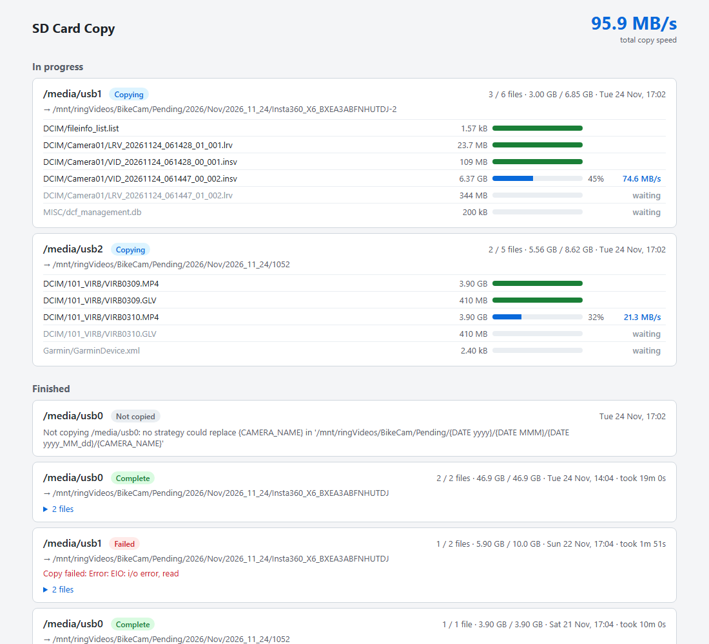

# sd-card-copy

Copies SD cards and cameras to another folder, such as a NAS share, as soon as they are plugged in. It runs in Docker on a Raspberry Pi: [usbmount](#usbmount) mounts each drive and asks the server to copy it.

  * **Folders per camera and date** - the target path can include the date and details read from the card, such as the name set on a Garmin VIRB or the model and serial number of an Insta360 ([camera strategies](#config)).
  * **Nothing is overwritten** - every copy goes into a new folder. A drive is not copied at all if a token in the target path can't be filled in, for example a card from an unknown camera.
  * **Optionally empties the card** once it has been copied (`delete-source=true`).
  * **Puts an Insta360 camera to sleep** after copying by switching off its USB port, then back on so it charges ([afterCopy](#config)).
  * **Status page** - copies in progress with each file's progress and speed, the last 100 finished, and the server's logs ([status page](#status-page)).



## Copy requests

```
GET http://127.0.0.1:3000/copy-path?source-path=/media/usb0&delete-source=true
```

  * `source-path` - the folder to copy, usually the drive's mount point
  * `target-path` - optional if `targetPath` is set in the config
  * `delete-source` - `true` to delete everything on the drive once it has been copied

The copy runs in the background: the request returns once it has started. It returns `400` for a `source-path` outside `allowedSourcePaths`, `409` if that drive is already being copied, and `422` if a token in the target path can't be filled in, in which case nothing is copied or deleted.

## Status page

Served on `statusPort` (default `3001`), e.g. `http://<pi address>:3001`. Each drive copied is a session:

  * **In progress** - each file with its size and progress, and the speed of the file being copied. The total speed of every copy is at the top.
  * **Finished** - the last 10 sessions, with **More** to see older ones. Sessions that failed or were not copied show why. The last 100 sessions are kept in memory and lost when the server restarts.
  * **Logs** - opens a panel with the server's last 500 log entries, updating as new ones are written.

The status port only serves the page and the read only API it uses, so unlike `port` it can be reached from other machines:

  * `GET /api/status` - server-sent events with the sessions in progress and the total speed, every second
  * `GET /api/sessions/completed?offset=0&limit=10` - finished sessions, newest first
  * `GET /api/logs` - server-sent events with the last 500 log entries, then each new one

## Server Configuration

The server can be configured with a `.env` file and a json config file. In most cases the default `.env` file can be used and most config can be done in the json file.

### .env

```
port=3000
statusPort=3001
configPath=config.json
logPath=logs/log.txt
logType=both
```
paths are all relative to the `.env` file which should located in the `data` folder.

**port**

Defaults to `3000`

**statusPort**

Defaults to `3001`. Serves the status page, which shows the copies in progress and the last 100 finished, and nothing else, so unlike `port` it can be opened to other machines.

**configPath**

Defaults to `config.json`

**logPath**

Defaults to `logs/log.txt`. Logs are rotated daily.

**logType**

Can be `file`. `console` or `both`. Defaults to `both`

### Config

By default a json config file is loaded from `data/config.json`. This can also be a `js` file.

```js
module.exports = {
    targetPath: "C:/video/{DATE yyyy}/{DATE MMM}",
    allowedSourcePaths: ["/media"],
    strategies: [(token) => (token === 'MY_TOKEN' ? 'REPLACED_CONTENT' : undefined)],
}
```

**allowedSourcePaths**

Optional but recommended. A list of folders that `source-path` must be in (or equal to). Requests for any other `source-path` are rejected with a `400`. As copying can delete the source this stops a request from emptying anything other than your SD card mounts. If not set any `source-path` is allowed.

**targetPath**

Optional. If set provides the default target path when copying so that it does not have to be specified for each request. Every copy goes into a new folder: if the target folder already exists `-2` (then `-3`...) is appended so files are never overwritten, for example when a camera's internal drive and SD card are copied to the same `{CAMERA_NAME}` folder. The following tokens can be included:

  * `{TIMESTAMP}` - replaced with milliseconds since epoch
  * `{DATE}` - will be replaced with the default javascript `toDateString()` formatted date.
  * `{DATE yyyy_MM_dd}` / `{DATE "EEE do MMM yyyy"}` Formatted date using [date-fns formatting tokens](https://date-fns.org/v2.28.0/docs/format).

**strategies**
Custom path replacement strategies can be included in your config. The strategy must be a `TokenReplacementStrategy`:

[//]: # (ts-command-line-args_write-markdown_insertCodeBelow file="sd-card-copy-server/src/contracts.ts" codeComment="typescript" )
```typescript
export type TokenReplacementStrategy = (
    tokenName: string, // Given {DATE} will be DATE
    tokenArgs: string[] | undefined, // Given {DATE someFormat, someOtherArg} will be ['someFormat', 'someOtherArg']
    token: string, // Given {DATE} will be {DATE}
    targetPath: string, // entire target path e.g. C:/fileSump/{TOKEN_ONE}/{TOKEN_TWO}
    sourcePath: string // source folder we are copying from
) => string | Promise<string | undefined> | undefined; // if token cannot be handled by strategy return undefined
```
[//]: # (ts-command-line-args_write-markdown_insertCodeAbove)
example strategies can be seen at `sd-card-copy-server\src\strategies`

**Camera strategies**

The camera strategies read details from the card being copied. Add them to `strategies` in a `js` config file:

```js
const garmin = require('../dist/server/strategies/garmin.strategy.js');
const insta360 = require('../dist/server/strategies/insta360.strategy.js');

module.exports = {
    targetPath: '/mnt/videos/{DATE yyyy_MM_dd}/{CAMERA_NAME}',
    strategies: [garmin.garminDeviceName, garmin.garminDeviceId, garmin.garminModelName, insta360.insta360Camera],
};
```

  * `{CAMERA_NAME}` - a folder name unique to the camera: the name set on a Garmin camera, or model and serial number for an Insta360 (e.g. `Insta360_X6_ABC123DEF45678`)
  * `{GARMIN_DEVICE_NAME}`, `{GARMIN_DEVICE_ID}`, `{GARMIN_MODEL_NAME}` - from `Garmin/GarminDevice.xml`
  * `{INSTA360_MODEL}`, `{INSTA360_SERIAL}` - from `DCIM/fileinfo_list.list` (tested with an X6)

**afterCopy**

Optional. Functions called after each copy request has finished, whether it copied, failed or was refused, with its `CopyParams` and a function returning the source paths of the copies still running.

`insta360PowerCycle` turns off the USB power to an Insta360 camera once its drives have been dealt with (`delete-source=true`), so that it leaves file transfer mode and goes to sleep. This happens whether the drives were copied, had nothing to copy, failed or were refused. Ejecting the drives is not enough: the camera stays awake while it has USB power. It waits a minute after a drive finishes so the camera's other drive has been requested, and until that drive has finished too. After `offMinutes` (default 5) the power is turned back on so the camera charges. Set the camera's auto power off to less than `offMinutes`. Copies from other ports carry on.

```js
module.exports = {
    // ...
    afterCopy: [insta360.insta360PowerCycle({ offMinutes: 5 })],
};
```

This uses [uhubctl](https://github.com/mvp/uhubctl), so the camera must be plugged into a hub that can switch the power of each port (most hubs can't, check the list of compatible hubs). The container needs access to the USB devices, and write access to `/sys/devices` so it can de-authorise the camera first (otherwise Linux kernels before 6.0 turn the port's power straight back on):

```yaml
    volumes:
      - /dev/bus/usb:/dev/bus/usb
      - /sys/devices:/sys/devices
    device_cgroup_rules:
      - 'c 189:* rmw'
```

## usbmount

[Usbmount](https://github.com/rbrito/usbmount) is a tool to automatically mount any usb drive that's inserted. I had some issues getting it to work on my raspberry pi though so I'll record the steps here (mostly so that when I forget in a months time I've documented it!).

**Clone the repo**

```bash
git clone https://github.com/rbrito/usbmount.git
cd usbmount
```

**Install Dependencies**

```bash
sudo apt-get update && sudo apt-get install -y debhelper build-essential
```

**Build**

```bash
cd usbmount
sudo dpkg-buildpackage -us -uc -b
```

**Install**

```bash
cd ..
sudo apt-get install -f ./usbmount_0.0.24_all.deb 
sudo reboot now

```

**Support exfat SD cards**

```bash
sudo apt-get install exfat-fuse exfat-utils
sudo nano /etc/usbmount/usbmount.conf
```
Add `exfat` to the `FILESYSTEMS` list

**Logs**

```bash
journalctl -u 'usbmount*' -f
```

**Start Copy**

`usbmount` can kick off a copy operation by making a request to our server when a drive is inserted. It runs every executable file in `/etc/usbmount/mount.d` after mounting a drive (file names must not contain a `.`):

```bash
sudo nano /etc/usbmount/mount.d/makeStartCopyRequest
```

Copy the following:

[//]: # (ts-command-line-args_write-markdown_insertCodeBelow file="examples/usbMountHook.js" codeComment="js" )
```js
#!/usr/bin/env node

const http = require('http');

async function makeRequest() {
    await http.get(`http://127.0.0.1:3000/copy-path?source-path=${process.env.UM_MOUNTPOINT}`);
}

makeRequest();

```
[//]: # (ts-command-line-args_write-markdown_insertCodeAbove)
Make the file executable:
```bash
sudo chmod +x /etc/usbmount/mount.d/makeStartCopyRequest
```

## Docker

### docker compose

This is how I run it on a Raspberry Pi, copying to a NAS share mounted at `/mnt/ringVideos`:

```yaml
services:
  sd-card-copy:
    container_name: sd-card-copy
    image: roaders/sd-card-copy:latest
    restart: unless-stopped
    volumes:
      - type: bind
        source: /mnt
        target: /mnt
        bind:
          propagation: rslave # sees the NAS share even if it is mounted after the container starts
      - /home/pi/docker/sd-card-copy/data:/usr/src/app/data
      - type: bind
        source: /media
        target: /media
        bind:
          propagation: shared # sees drives mounted by usbmount
      # only needed for insta360PowerCycle
      - /dev/bus/usb:/dev/bus/usb
      - /sys/devices:/sys/devices
    device_cgroup_rules:
      - 'c 189:* rmw' # only needed for insta360PowerCycle
    ports:
      - 127.0.0.1:3000:3000 # copy requests, from this machine only
      - 3001:3001 # status page
    environment:
      - TZ=Europe/London
```

Upgrade with `docker compose pull && docker compose up -d`.

### docker run

the command that you need to run will depend on your setup and specifically what you want to copy to where. I use this command:

```bash
$ docker run -it -p 127.0.0.1:3000:3000 -p 3001:3001 -v /someLocalStorage/data:/usr/src/app/data -v /mnt:/mnt --mount type=bind,source=/media,target=/media,bind-propagation=shared --name sd-card-copy roaders/sd-card-copy:latest
```

#### -it 
attach a terminal session so we can see what is going on
#### -p 127.0.0.1:3000:3000
connect local port 3000 to the exposed internal port 3000. Binding to `127.0.0.1` means only the machine itself (and so the `usbmount` hook) can make requests. The server has no authentication and can delete files so only use `-p 3000:3000` if you need to make requests from other machines.
#### -p 3001:3001
the status page, at `http://<pi address>:3001`. It can't start copies or change anything so it can be reached from other machines.
#### -v /someLocalStorage/data:/usr/src/app/data
map a folder to the data folder used in the container so we can configure the instance and store logs
#### -v /mnt:/mnt
map the `mnt` folder into the container. This allows me to copy to `/mnt/someFolder`. YOu will need to map and folder you want to copy to.
#### --mount type=bind,source=/media,target=/media,bind-propagation=shared
this maps the `media` folder to `media` within the container. This will also map newly mounted usb drives as well
#### --name sd-card-copy
name of the container
#### roaders/sd-card-copy:latest
the image to base the container on

### Upgrade:

```bash
$ docker pull roaders/sd-card-copy:latest
$ docker stop sd-card-copy
$ docker rm sd-card-copy
$ docker run -it --name sd-card-copy -p 127.0.0.1:3000:3000 -p 3001:3001 -v /someLocalStorage/data:/usr/src/app/data -v /mnt:/mnt --mount type=bind,source=/media,target=/media,bind-propagation=shared roaders/sd-card-copy:latest
```

## Development

The repository has two npm workspaces: `sd-card-copy-server` (NestJS) and `sd-card-copy-ui` (the status page, using Lit and Vite). Both build into `dist`, which the Docker image runs.

```bash
npm install
npm start                       # server, rebuilding on changes
npm start -w sd-card-copy-ui    # status page on Vite's dev server, using the server running on this machine
npm run verify-release          # lint, build, test and check this readme is up to date
```
